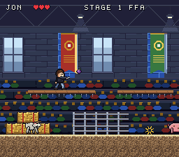

# COMRADES

A best friend adventure through the stages of life, for the Super Nintendo.


Play as **Jon** or **Wes** and fight your way through memories, one stage at a time.

## Play it

Download [`rom/comrades.sfc`](rom/comrades.sfc) and open it in any SNES emulator
(Mesen, bsnes, snes9x). It runs on real hardware via a flash cart too.

| Button | Action |
| --- | --- |
| D-pad | Move, pick your comrade on the title screen |
| B | Jump (hold for a higher jump) |
| Y | Fling a grape off your spoon |
| Start | Start the game |

Stomp critters or pelt them with grapes (hold B while stomping for a big bounce).
Goats lower their horns and charge, pigs are slow but take four hits, and chickens
hop around the catwalks. Watch out for the water troughs. Grab hearts to heal, and
reach the trophy on the stage at the end of the hall.



**Jon** jumps higher and floatier. **Wes** runs faster and his grapes hit twice as hard.

## Stages

1. **FFA Convention** (playable demo): where Jon and Wes met, flinging grapes off spoons.
2. Jam Sessions
3. Bar Town Nights
4. Chicago Fest
5. The Courthouse
6. Golden Years

Bonus rounds between stages: Road Ride (motorcycle race) and The Range.

## Building

Needs [PVSnesLib](https://github.com/alekmaul/pvsneslib) and Python 3 with Pillow and NumPy.

```sh
export PVSNESLIB_HOME=/path/to/pvsneslib
make
```

All art and audio is generated by the scripts in `tools/` (heroes, critters, stage tiles, font,
logo, plus the music and sound effects as Impulse Tracker modules played by SNESMOD),
so it stays inside real SNES limits: 16-colour palettes, 8x8 tiles, 32x32 and 16x16 sprites.
Previews of the generated art are in `art/`.
