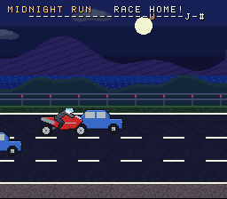
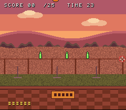
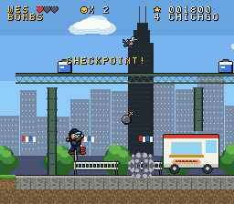
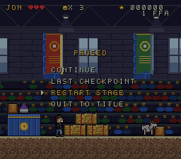

# COMRADES

A best friend adventure through the stages of life, for the Super Nintendo.


Play as **Jon** or **Wes** and fight your way through six memories, each with its own
enemies and a boss at the end. Like Super Mario Bros. 2, you pick who plays before every
chapter, and a bonus round follows every chapter.

## Play it

Download [`rom/comrades.sfc`](rom/comrades.sfc) and open it in any SNES emulator
(Mesen, bsnes, snes9x). It also runs on real hardware with a flash cart.

| Button | Platforming | Road Ride | The Range |
| --- | --- | --- | --- |
| D-pad | Move | Up/Down change lanes | Aim |
| B | Jump (hold for higher) | Throttle | Fire |
| Y | Throw / fire (hold for Rapid) | | Reload |
| Start | Pause menu | | |

On the title screen, **Select** picks the chapter to start from. Left/Right on a chapter
card switches between Jon and Wes.

You can stomp enemies or hit them with your throw. Hold B while stomping for a big bounce,
and chain stomps without landing for double points each time. Hazards (troughs, pits, storm
drains, the river, the pool) cost a heart.

**Lives and score.** You start with 3 lives and earn another every 20,000 points. Enemies,
props and stars give points, a cleared chapter pays 500 per heart left plus 5,000 for the
boss, and every fourth enemy drops a star. Lose your hearts and you lose a life (and your
weapon) and go back to the last checkpoint flag. Lose every life and you can continue
from the start of the chapter with your score reset.

**Breakable props.** Crates, record boxes, trash cans, coolers, file boxes and gift boxes
crack on the first hit and break on the second (a bomb or a stomp breaks them at once).
They hide stars, hearts, 1UPs and weapons:

| Weapon | |
| --- | --- |
| Grapes | The default lob |
| Spread | Three lobs at once |
| Rapid | Hold Y for a stream of fast bolts |
| Pick | A guitar pick boomerang that flies out and comes back, hitting on the way |
| Bombs | Lobbed bombs that blow up in a big blast |

**Pause menu.** Start pauses: continue, go back to the last checkpoint, restart the
chapter, or quit to the title.

**Jon** jumps higher. **Wes** hits harder.

## Chapters

| | Chapter | Boss |
| --- | --- | --- |
| 1 | **FFA Convention**: where Jon and Wes met, flinging grapes off spoons | Champion Bull |
| ★ | **Road Ride**: race the B-King against the RC51 to the diner. A win gives that rider +1 max heart | |
| 2 | **Jam Sessions**: learning guitar at Wes's house | Feedback, the amp stack |
| ★ | **The Range**: plates, bottles and clays. Hit 25 in 40 seconds for an extra life, and that shooter gets the double shot | |
| 3 | **Bar Town Nights**: punk shows, cheap drinks and a long walk home | The Bouncer |
| ★ | **Midnight Run**: the race home at night, with the traffic rearranged | |
| 4 | **Chicago Fest**: a festival weekend in the windy city | Pigeon King |
| ★ | **Dusk at the Range**: the range at sunset, with faster targets | |
| 5 | **The Courthouse**: the night shift, mopping a castle of a courthouse | The Judge |
| ★ | **Sunset Ride**: one last race down the coast, against a faster rival | |
| 6 | **Golden Years**: old friends, still getting into trouble | Father Time |

 
 
 
 
 
 
 
 

## Building

Needs [PVSnesLib](https://github.com/alekmaul/pvsneslib) and Python 3 with Pillow and NumPy.

```sh
export PVSNESLIB_HOME=/path/to/pvsneslib
make
```

The ROM is 1MB LoROM. All the art and audio comes from the scripts in `tools/`:

- `heroes.py`: Jon and Wes.
- `stages/`: one script per chapter, built on `stagekit.py`.
- `foes.py`: enemies, bosses and projectiles.
- `bonus.py`: the bikes, the road and the range.
- `font.py` and `title.py`: the logo and the font.
- `items.py`: pickups, weapons, explosions and the breakable props.
- `music.py`: 12 songs and 17 sound effects, written as Impulse Tracker modules and played by SNESMOD.

`reach.py` checks that every stage can be cleared with a 38 pixel jump, lower than Wes's.

`gen_data.py` writes `src/data.asm` and `src/assets.c`. Because the assets are generated,
they stay inside real SNES limits: 16 colour palettes, 8x8 tiles, and 32x32 and 16x16
sprites. Previews of the generated art are in `art/`.

Game code is in `src/`:

- `main.c`: title, chapter cards, flow and ending.
- `stage.c`: the platformer, weapons, props, checkpoints and the pause menu.
- `fast.asm`: the sprite drawing helpers, in assembly because they run dozens of times a frame.
- `boss.c`: the bosses.
- `race.c` and `range.c`: the bonus rounds.
